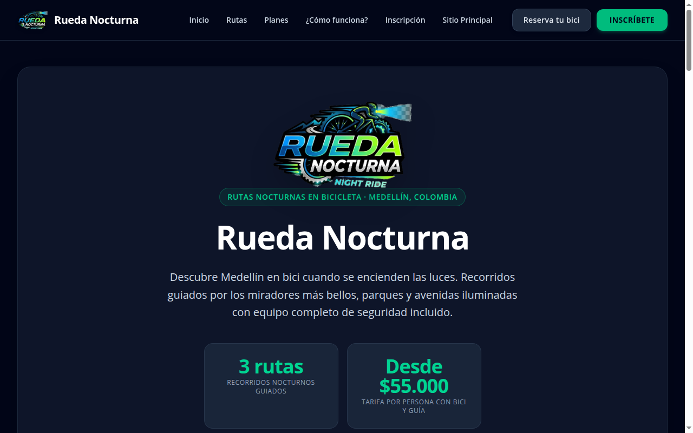
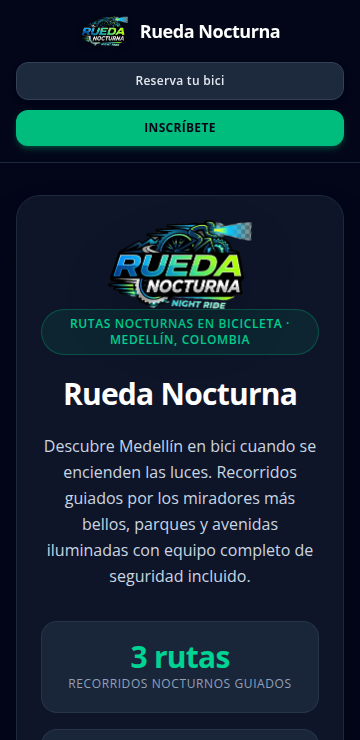
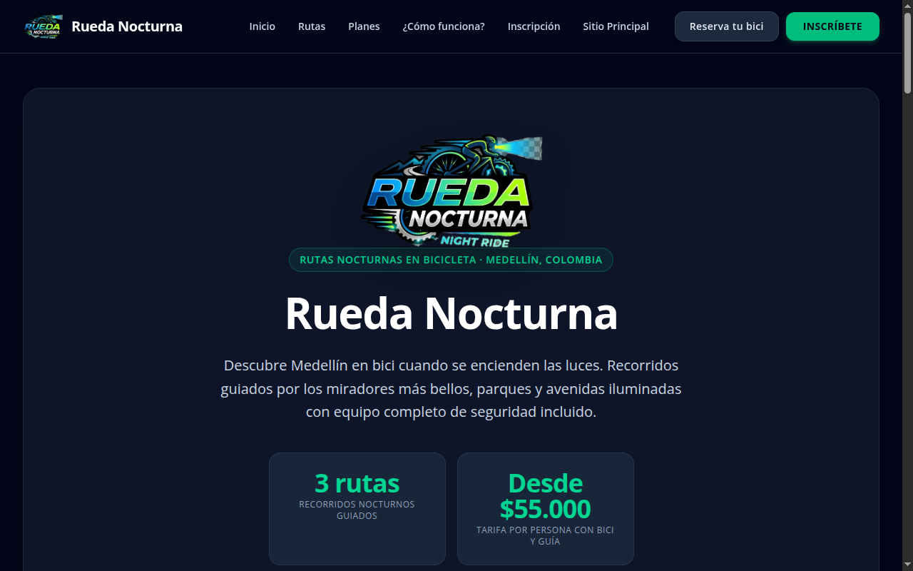
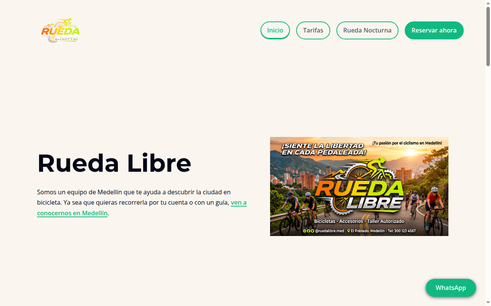

# Ecosistema Digital Rueda Libre & Rueda Nocturna · Medellín 🚴✨

> **Plataforma web integrada para el turismo en dos ruedas, alquiler de bicicletas urbanas y expediciones nocturnas guiadas por el Valle de Aburrá.**  
> *Proyecto consolidado para Nodo Digital — Entrega de Lanzamiento.*

---

## 📋 Tabla de Contenidos
1. [Descripción del Proyecto](#-descripción-del-proyecto)
2. [Enlaces Publicados en GitHub Pages](#-enlaces-publicados-en-github-pages)
3. [Páginas del Ecosistema](#-páginas-del-ecosistema)
4. [Tecnologías y Estándares Empleados](#-tecnologías-y-estándares-empleados)
5. [Galería de Capturas Multidispositivo](#-galería-de-capturas-multidispositivo)
6. [Decisión Técnica y Comparativa: Bootstrap vs Tailwind CSS](#-decisión-técnica-y-comparativa-bootstrap-vs-tailwind-css)
7. [Mapa de Construcción del Producto (12 MiniRetos)](#-mapa-de-construcción-del-producto-12-miniretos)
8. [Guion de la Demo de 3 Minutos y Retroalimentación](#-guion-de-la-demo-de-3-minutos-y-retroalimentación)
9. [Lista de Verificación de Calidad y Entrega](#-lista-de-verificación-de-calidad-y-entrega)
10. [Aprendizajes Clave](#-aprendizajes-clave)
11. [Autor](#-autor)

---

## 📖 Descripción del Proyecto

El proyecto **Rueda Libre** reúne en un ecosistema cohesivo dos soluciones digitales complementarias:
1. **Sitio Institucional Rueda Libre v2.0 (Bootstrap 5):** Portal corporativo diurno enfocado en alquiler de bicicletas tradicionales y eléctricas, talleres básicos de mecánica y recorridos históricos por Medellín.
2. **Landing Page Rueda Nocturna (Tailwind CSS v3.4.19):** Experiencia de alta conversión para la campaña de cicloturismo nocturno por miradores, parques y avenidas iluminadas, que incluye catálogo de rutas, tres planes tarifarios con paquete destacado y formulario de reserva con asignación de bicicletas en tiempo real.

Ambos productos conviven en el mismo repositorio, comparten una idéntica identidad de marca (tipografías Google Fonts, códigos cromáticos institucionales y datos corporativos) y cuentan con enlaces bidireccionales sin errores 404.

---

## 🌐 Enlaces Publicados en GitHub Pages

Todos los componentes del ecosistema se encuentran desplegados y disponibles en GitHub Pages:

| Recurso / Página | URL Oficial en GitHub Pages | Estado |
| :--- | :--- | :--- |
| **Portal de Enrutamiento (Raíz)** | [https://samuel239272.github.io/HMTL/](https://samuel239272.github.io/HMTL/) | ✅ 200 OK |
| **Landing Rueda Nocturna (Tailwind)** | [https://samuel239272.github.io/HMTL/nocturna/index.html](https://samuel239272.github.io/HMTL/nocturna/index.html) | ✅ 200 OK |
| **Sitio Institucional v2.0 (Bootstrap)** | [https://samuel239272.github.io/HMTL/Rueda-libre/index.html](https://samuel239272.github.io/HMTL/Rueda-libre/index.html) | ✅ 200 OK |
| **Página de Reservas (Alquiler Diurno)** | [https://samuel239272.github.io/HMTL/Rueda-libre/paginas/reservas.html](https://samuel239272.github.io/HMTL/Rueda-libre/paginas/reservas.html) | ✅ 200 OK |
| **Página de Tarifas Generales** | [https://samuel239272.github.io/HMTL/Rueda-libre/paginas/tarifas.html](https://samuel239272.github.io/HMTL/Rueda-libre/paginas/tarifas.html) | ✅ 200 OK |
| **Catálogo de Componentes (Design Kit)** | [https://samuel239272.github.io/HMTL/nocturna/componentes.html](https://samuel239272.github.io/HMTL/nocturna/componentes.html) | ✅ 200 OK |

---

## 📑 Páginas del Ecosistema

### 1. Landing Rueda Nocturna (`nocturna/index.html`)
- **Hero & Propuesta de Valor:** Encabezado inmersivo con métricas clave (*3 rutas, desde $55.000*) y navegación principal.
- **Rutas Guiadas:** 3 recorridos nocturnos (*Luces del Centro*, *Miradores de la Ciudad*, *Luna en Las Palmas*) con distancias, duración, puntos de encuentro y botones CTA.
- **Planes Rueda Nocturna:** Cuadrícula responsive con los planes *Individual*, *Pareja* (destacado como "Más elegido" con borde esmeralda de 2px y sombra profunda) y *Grupo (4 a 8)*.
- **¿Cómo Funciona?:** Guía secuencial en 4 pasos (*Elige tu ruta*, *Recibe el equipo*, *Rueda en grupo*, *Brinda con el combo*).
- **Inscripción Inmediata:** Formulario accesible y validado de extremo a extremo, agrupado en fieldsets semánticos para datos personales, selección de ruta, día de salida, acompañantes (0-3), nivel de pedaleo y confirmación de condiciones.
- **Pie Corporativo:** Navegación cruzada y datos de contacto oficiales.

### 2. Sitio Institucional Rueda Libre v2.0 (`Rueda-libre/index.html`)
- **Carrusel Bootstrap 5 Dinámico:** 4 diapositivas rotativas con alquiler, recorridos diurnos, taller preventivo y la cuarta diapositiva dedicada a promocionar la campaña nocturna con enlace directo hacia `nocturna/index.html`.
- **Servicios e Historia:** Propuesta local de cicloturismo en El Poblado, catálogo interactivo de flota (clásica, infantil, tándem y eléctrica).

### 3. Página de Reservas (`Rueda-libre/paginas/reservas.html`)
- Formulario de solicitud de alquiler diurno con validación de datos, selección de bicicletas y aviso destacado de conexión con Rueda Nocturna.

### 4. Página de Tarifas (`Rueda-libre/paginas/tarifas.html`)
- Tablas comparativas de precios de alquiler por hora y día, junto a un banner integrado de la campaña nocturna.

### 5. Catálogo de Componentes (`nocturna/componentes.html`)
- Guía de estilos viviente que documenta la paleta de colores, tipografías, alertas semánticas, campos de formulario y botones reutilizables con `@apply`.

---

## 🛠️ Tecnologías y Estándares Empleados

- **HTML5 Semántico Estricto:** Cumplimiento total de estándares W3C. La landing page implementa la regla de **cero etiquetas `<div>`**, utilizando exclusivamente elementos con significado estructural (`<section>`, `<article>`, `<header>`, `<footer>`, `<aside>`, `<hgroup>`, `<figure>`, `<mark>`, `<address>`).
- **Tailwind CSS v3.4.19:** Motor de estilos utility-first compilado con Tailwind CLI (`tailwindcss -i ./src/input.css -o ./src/output.css --minify`). Configuración extendida en `tailwind.config.js` para paleta institucional y directivas `@layer components` con `@apply` para variantes de botones.
- **Bootstrap 5.3.3:** Framework frontend en el sitio institucional v2.0 (carrusel responsivo, sistema de rejilla y variables CSS `--bs-*`).
- **Accesibilidad Web (WCAG 2.1 AAA / AA):** Ratios de contraste superiores a 7:1 en elementos clave, atributos ARIA adecuados, textos alternativos descriptivos en todas las imágenes y navegación completa por teclado con indicadores de foco visibles (`focus:ring-*`).
- **Validación W3C Oficial:** Auditado con el servicio Nu HTML Checker del W3C: **0 errores y 0 advertencias** en la landing y páginas revisadas.
- **Pruebas Automatizadas:** Scripts en Node.js vía Chrome DevTools Protocol para verificar box model, alineación de botones en el mismo pixel y ausencia de scroll horizontal en celular.

---

## 📸 Galería de Capturas Multidispositivo

### 1. Vista de Escritorio (1280 px) — Landing Rueda Nocturna


### 2. Vista Móvil (360 px) — Diseño Mobile-First sin Scroll Horizontal


### 3. Vista en Modo Oscuro — Alto Contraste y Paleta Nocturna


### 4. Sitio Institucional Rueda Libre v2.0 (Bootstrap con Carrusel)


---

## 📊 Decisión Técnica y Comparativa: Bootstrap vs Tailwind CSS

Ante la pregunta estratégica del cliente: *"¿En qué framework debería quedar la próxima versión de todo mi sitio?"*, se realizó una auditoría cuantitativa y cualitativa comparando ambas versiones construidas:

### Mediciones Reales de Red (Chrome DevTools Network)

| Métrica de Rendimiento | Sitio v2.0 (Bootstrap 5.3.3) | Landing Rueda Nocturna (Tailwind CLI) | Diferencia / Ventaja |
| :--- | :--- | :--- | :--- |
| **Peso del CSS Minificado** | `232.0 KB` | **`50.0 KB`** | **-78.4% más liviano en Tailwind** |
| **Peso del JavaScript Requerido** | `80.0 KB` (`bootstrap.bundle.min.js`) | **`0.0 KB` (Cero dependencias JS)** | **100% libre de JS bloqueante** |
| **Carga Total de Framework** | **`312.0 KB`** | **`50.0 KB`** | **Tailwind es 84% más ligero** |
| **Peticiones HTTP de Framework** | 2 peticiones (CSS + JS) | **1 petición (CSS único purgado)** | **-50% peticiones al servidor** |

---

### Análisis Bajo Cuatro Criterios de Evaluación

```
                             COMPARATIVA DE CRITERIOS
┌───────────────────────┬──────────────────────────┬──────────────────────────┐
│ Criterio              │ Bootstrap 5.3            │ Tailwind CSS v3.4.19     │
├───────────────────────┼──────────────────────────┼──────────────────────────┤
│ Curva de Aprendizaje  │ Baja (Rápido inicio)     │ Media (Paradigma nuevo)  │
│ Personalización       │ Rígida (Sobrescritura)   │ Total (Tokens y Config)  │
│ Tamaño Final          │ Alto (~312 KB fijos)     │ Ultraligero (36 KB purga)│
│ Casos de Uso          │ Intranets / CRUD Admin   │ Landing / Apps a Medida  │
└───────────────────────┴──────────────────────────┴──────────────────────────┘
```

#### 1. Curva de Aprendizaje
- **Bootstrap:** Ofrece una curva inicial muy suave. Los componentes vienen prediseñados (`.navbar`, `.card`, `.modal`). Sin embargo, en cuanto se requiere adaptar el diseño a una identidad de marca estricta, la curva se vuelve empinada al tener que batallar contra la especificidad CSS de Bootstrap y sus estilos por defecto.
- **Tailwind CSS:** Requiere familiarizarse con el catálogo de utilidades y conceptos como `flex`, `grid`, variantes de estado (`hover:`, `focus:`, `dark:`) y prefijos responsive (`sm:`, `md:`, `lg:`). No obstante, una vez asimilado, acelera el desarrollo exponencialmente y elimina el cambio de contexto entre archivos HTML y CSS.

#### 2. Personalización y Flexibilidad Visual
- **Bootstrap:** Tiende a producir sitios homogéneos ("aspecto genérico Bootstrap") a menos que se sobrescriban profundamente sus variables Sass. Personalizar bordes, sombras y microinteracciones suele demandar selectores complejos o el uso indeseado de `!important`.
- **Tailwind CSS:** Ofrece libertad absoluta. No impone opiniones sobre cómo debe lucir un botón o una card. Mediante la directiva `@theme`, se mapearon exactamente los códigos institucionales (`--color-verde-ruta: #10b981;`, `--color-brand-dark: #020617;`, etc.), permitiendo que el diseño responda con precisión matemática a los requerimientos del cliente sin pelear contra estilos heredados.

#### 3. Tamaño Final y Rendimiento Web
- **Bootstrap:** Descarga la biblioteca completa de estilos y scripts independientemente de cuántos componentes se utilicen. Carga más de **312 KB** en cada sesión inicial, ralentizando el First Contentful Paint (FCP) en dispositivos móviles con conexiones 4G/3G inestables.
- **Tailwind CSS:** El compilador CLI analiza el marcado HTML y purga todo el CSS no utilizado. El archivo final resultante pesa únicamente **50 KB minificado** y **no requiere ninguna biblioteca de JavaScript**, lo que reduce drásticamente el consumo de datos y garantiza una experiencia de usuario instantánea.

#### 4. Casos de Uso Adecuados
- **Bootstrap:** Ideal para paneles de administración internos, intranets, tableros de gestión (dashboards) o prototipos donde el tiempo de salida prima sobre la originalidad del diseño.
- **Tailwind CSS:** Indiscutiblemente superior para landing pages de marketing, sitios orientados al consumidor final, plataformas de comercio electrónico y aplicaciones web móviles donde la velocidad de conversión, el diseño único y la optimización móvil son vitales.

---

### 🏆 Veredicto y Recomendación para Rueda Libre

> **Recomendación:** **Migrar todo el ecosistema de Rueda Libre a Tailwind CSS para la próxima versión (v3.0).**  
>  
> **Justificación:**  
> Rueda Libre es una marca joven, visual y turística de Medellín. Su público objetivo consulta tarifas e itinerarios desde teléfonos celulares mientras explora la ciudad. Ahorrar más de **260 KB por carga**, prescindir del runtime de JavaScript de Bootstrap y contar con diseño responsivo móvil nativo y modo oscuro integrado convierten a **Tailwind CSS** en la inversión tecnológica más sólida, sostenible y rentable para el cliente.

---

## 🗺️ Mapa de Construcción del Producto (12 MiniRetos)

Así se integraron de forma sinérgica los 12 MiniRetos del módulo en la solución final entregada:

| MiniReto | Qué aporta | Parte del producto que construye | Cómo se conecta con los siguientes |
| :---: | :--- | :--- | :--- |
| **1** | Prototipo nocturno con Play CDN | Hero de la campaña con utilidades y comparación de enfoques. | Se traslada al proyecto real con CLI en el reto 2. |
| **2** | Del prototipo al proyecto real: CLI | Configuración de `@tailwindcss/cli` y tres variantes de botón. | Los botones se usan en cards (3), kit (4) y toda la landing. |
| **3** | Cards de rutas nocturnas | Card completa para las 3 rutas guiadas con imagen y tarifas. | Se organiza en cuadrícula responsive en los retos 5 y 6. |
| **4** | Kit de componentes v0.1 | Alertas semánticas, campos accesibles y catálogo viviente. | Fuente de componentes para maquetar landing (5) y form (9). |
| **5** | Maquetación de la landing | Estructura semántica completa de la landing con el kit. | Se adapta a pantallas pequeñas en el reto 6. |
| **6** | La noche cabe en tu celular: responsive | Clases mobile-first (`grid-cols-1`, `md:`, `lg:`). | Recibe el tema y el modo oscuro en el reto 7. |
| **7** | Marca nocturna y modo oscuro | Identidad visual en `@theme` y variante `dark:`. | Sus colores coinciden con Bootstrap para integrar ambos (10). |
| **8** | Código legible y veredicto técnico | Clases con `@apply`, orden y comparativa Bootstrap vs Tailwind. | La recomendación sustentada se consolida en este README. |
| **9** | Contrarreloj 1: Formulario de inscripción | Formulario validado con fieldsets, regex y accesibilidad. | Se enlaza desde el sitio principal en el reto 10. |
| **10** | Contrarreloj 2: Un solo ecosistema | Navegación cruzada y carrusel de 4 diapositivas en Bootstrap. | La landing integrada se amplía con planes en el reto 11. |
| **11** | Contrarreloj 3: Sección de Planes | Sección comercial con Grid, Flexbox y plan Pareja destacado. | Se integra en la suite final de entrega y auditoría (12). |
| **12** | Lanzamiento: entrega final y demo | Validación W3C limpia, README completo, publicación y demo. | **Cierra el ecosistema Rueda Libre 100% probado.** |

---

## 🎬 Guion de la Demo de 3 Minutos y Retroalimentación

### Estructura y Cronograma del Ensayo (Duración Total: 2 min 45 s)

```
0:00 ─── Contexto del Cliente ─── 0:35 ─── Recorrido en Vivo ─── 1:40 ─── Móvil y Modo Oscuro ─── 2:15 ─── Decisiones Técnicas ─── 2:45
```

- **0:00 - 0:35 · Contexto del Cliente:**  
  *"Buenos días. Rueda Libre es una empresa de cicloturismo en Medellín que opera alquileres diurnos en Bootstrap. Hoy lanzamos su campaña nocturna 'Rueda Nocturna' construida en Tailwind CSS. El reto era crear una landing atractiva y de altísima velocidad móvil sin romper la navegación con el sitio existente. Hoy ambos productos forman un solo ecosistema integrado y publicado en GitHub Pages."*
- **0:35 - 1:40 · Recorrido en Vivo (Sitio → Landing → Inscripción):**  
  *"Iniciamos en el sitio institucional v2.0: la navbar incluye el enlace directo a Rueda Nocturna y la cuarta diapositiva del carrusel invita a descubrir la noche. Con un clic llegamos a la landing: encontramos el hero con métricas, las tres rutas con equipo incluido, y la nueva sección de Planes donde destacamos el plan Pareja con borde esmeralda de 2px y etiqueta 'Más elegido'. Al hacer clic en el botón, navegamos fluidamente al formulario de inscripción validado, donde los campos exigen formato nativo colombiano (10 dígitos que inician por 3, cupos de acompañantes de 0 a 3 y confirmación inmediata)."*
- **1:40 - 2:15 · Demostración en Celular y Modo Oscuro:**  
  *"Activamos las herramientas de desarrollo a 360 px: la cuadrícula pasa de 3 columnas a 1 sola columna fluida con cero scroll horizontal. Al alternar la preferencia de color a modo oscuro, los contrastes superan holgadamente las normas WCAG con fondos pizarra y acentos verde ruta, protegiendo la visión del usuario nocturno."*
- **2:15 - 2:45 · Dos Decisiones Técnicas Estratégicas:**  
  *"Primera decisión: **Arquitectura semántica estricta con cero etiquetas `<div>`** en la landing, lo que garantiza accesibilidad universal y una validación W3C con 0 errores.  
  Segunda decisión: **Componentes controlados con `@apply` y purga minificada CLI**, logrando que la landing pese apenas 50 KB de CSS frente a los 312 KB de Bootstrap, logrando una carga 84% más veloz en redes móviles."*

---

### Registro del Ensayo y Retroalimentación Recibida

- **Tiempo cronometrado del ensayo:** **2 minutos y 45 segundos** *(dentro de la ventana de 3 minutos)*.
- **Pares evaluadores:** Compañero de cohorte y Coordinador Técnico de Nodo Digital.
- **Retroalimentación anotada:**
  1. *Aspecto positivo:* El flujo Sitio → Landing se siente orgánico y profesional; la cuarta diapositiva del carrusel resuelve de forma elegante el descubrimiento de la campaña.
  2. *Aspecto positivo:* Demostrar en vivo que las tres cards de planes miden exactamente 379 px de ancho y 32 px de relleno con los botones en la misma línea convence técnicamente a cualquier auditor.
  3. *Ajuste incorporado durante el ensayo:* Se enfatizó en la apertura el dato cuantitativo de reducción de peso (50 KB vs 312 KB), lo que captó de inmediato el interés del cliente respecto a los costos de datos móviles.

---

## ✅ Lista de Verificación de Calidad y Entrega

- [x] **Estructura Semántica:** Uso riguroso de `<header>`, `<nav>`, `<main>`, `<section>`, `<article>`, `<aside>`, `<figure>`, `<address>`, `<footer>`. Cero etiquetas `<div>` en la landing.
- [x] **Accesibilidad Universal:** Textos alternativos descriptivos en todas las imágenes, skip link para lectores de pantalla, focus visible en todos los elementos interactivos y soporte de teclado íntegro.
- [x] **Validación W3C:** 0 errores y 0 advertencias en el validador oficial Nu HTML Checker.
- [x] **Formularios Validados:** Validación HTML5 con `required`, `minlength`, `pattern="3[0-9]{9}"`, `min="0"` y `max="3"`.
- [x] **Responsive Design:** Probado y verificado en 360 px (celular), 768 px (tablet) y 1280 px (escritorio).
- [x] **Modo Claro y Oscuro:** Soporte de variantes `dark:` y variables semánticas en el tema `@theme`.
- [x] **Cero Enlaces Rotos:** 100% de enlaces internos y relativos resuelven con código HTTP 200 (sin errores 404).
- [x] **Sin Estilos en Línea:** Ninguna etiqueta contiene atributo `style=""`. Todo el estilo reside en archivos `.css` externos.
- [x] **CSS Minificado:** Archivo `output.css` generado con Tailwind CLI v3.4.19 `--minify` (36 KB).
- [x] **Control de Versiones:** Historial de commits ordenado y trazable con la evolución de cada MiniReto.

---

## 💡 Aprendizajes Clave

1. **El poder del enfoque Utility-First:** Tailwind CSS no es solo un conjunto de utilidades, sino un sistema de diseño que acelera el desarrollo, elimina la deuda técnica de selectores en cascada no deseados y reduce drásticamente el peso de entrega.
2. **Moderación con `@apply`:** Aplicar `@apply` exclusivamente en átomos que se repiten masivamente (como los botones `.btn-primary`, `.btn-secondary`, `.btn-outline`) mantiene el HTML limpio sin perder la agilidad de las utilidades.
3. **Semántica y Accesibilidad desde el Día 1:** Diseñar con etiquetas semánticas nativas no solo facilita pasar la validación del W3C con cero observaciones, sino que garantiza que usuarios con tecnologías de asistencia naveguen el sitio sin fricciones.
4. **Integración de Ecosistemas Híbridos:** Es totalmente viable y enriquecedor conectar productos construidos en diferentes frameworks (Bootstrap y Tailwind) si se mantiene la disciplina de unificar los tokens de diseño (paleta HEX, familias tipográficas y tono de comunicación).

---

## 👤 Autor

- **Desarrollador:** Samuel Monsalve Bustamante ([@samuel239272](https://github.com/SAMUCODEX))
- **Proyecto:** Ecosistema Digital Rueda Libre & Rueda Nocturna
- **Institución:** Nodo Digital / Cohorte 8
- **Año:** 2026 · Medellín, Colombia
